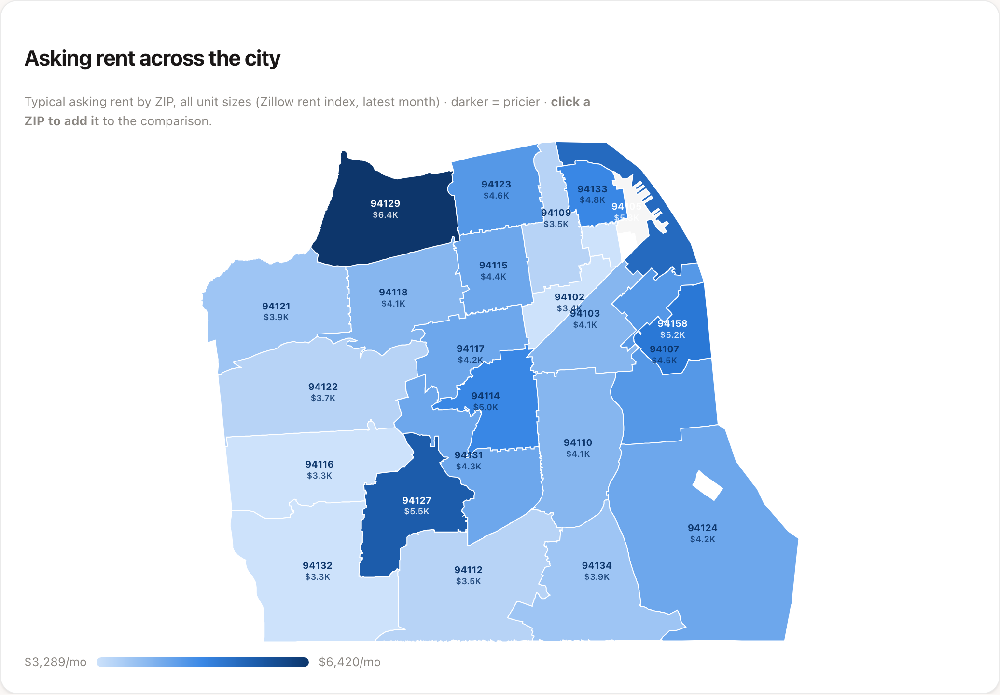
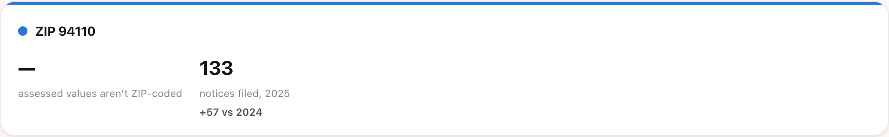
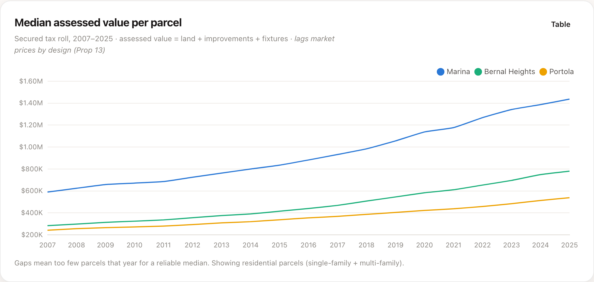
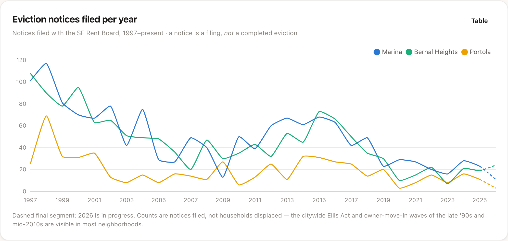
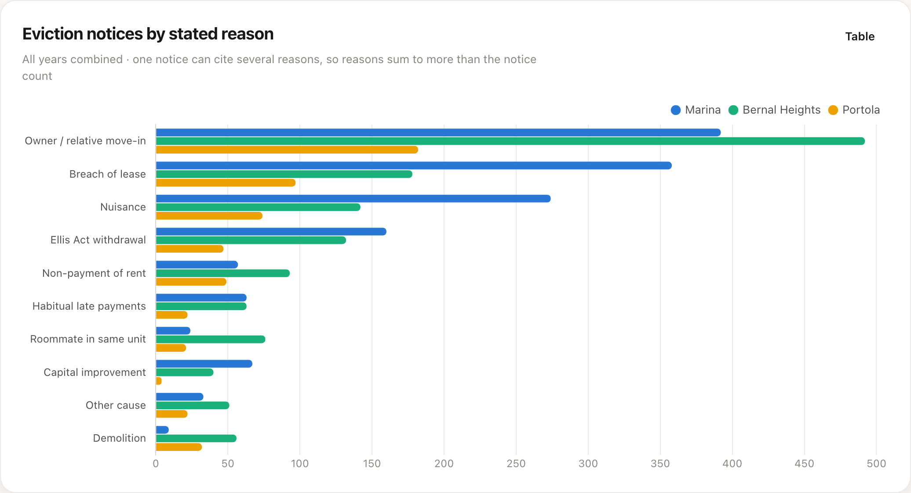
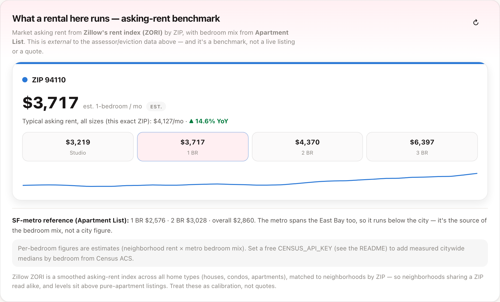
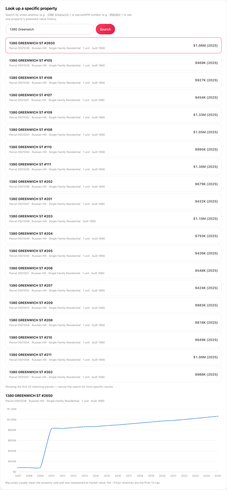
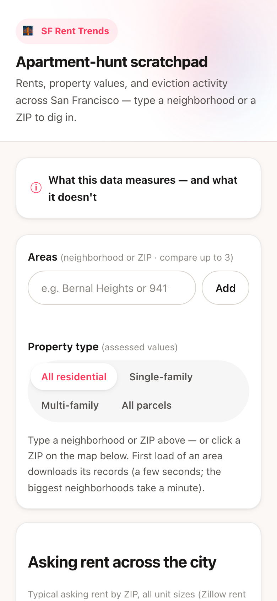

# SF Housing & Rent Trend Explorer

Get a feel for a San Francisco neighborhood while apartment hunting: a citywide rent heat map, historical assessed property values, eviction-notice activity, and an asking-rent benchmark by bedroom, searchable by neighborhood or ZIP.



## What it does

Type a neighborhood or a ZIP (compare up to three) and the app shows four things for each: where its asking rent sits on a citywide ZIP heat map, the median assessed value per parcel from 2007 to 2025, eviction notices filed per year since 1997, and a rent benchmark broken down by bedroom count. You can filter assessed values by property type, break evictions down by stated reason, and look up a single address or parcel to see its assessed-value history. Everything is cached locally after the first fetch. The backend is Python standard library only, and Chart.js is vendored, so the UI works offline once data is cached.

## Why I built it

I was apartment hunting and wanted one place to sanity-check a neighborhood: is rent here high or low for the city, is it climbing, what does the property and eviction history look like. The public data exists, but it is scattered across datasets that do not line up cleanly, and pulling it turned into the actual engineering work.

## Data sources

| Source | What it provides | API key | Updates |
|---|---|---|---|
| [Assessor Historical Secured Property Tax Rolls](https://data.sfgov.org/Housing-and-Buildings/Assessor-Historical-Secured-Property-Tax-Rolls/wv5m-vpq2) (`wv5m-vpq2`) | Assessed value (land + improvements + fixtures) per parcel per roll year, 2007 to 2025; property lookup | No | About yearly |
| [Eviction Notices](https://data.sfgov.org/Housing-and-Buildings/Eviction-Notices/5cei-gny5) (`5cei-gny5`) | Notices filed with the SF Rent Board, 1997 to present, with reason flags | No | Daily |
| [Zillow ZORI](https://www.zillow.com/research/data/) (ZIP level) | Asking-rent index by ZIP, all home types | No | Monthly |
| [Apartment List Rent Estimates](https://www.apartmentlist.com/research/category/data-rent-estimates) | SF-metro overall / 1BR / 2BR, supplies the bedroom mix | No | Monthly |
| [Census ACS B25031](https://www.census.gov/data/developers/data-sets/acs-5year.html) (optional) | Measured citywide median rent by bedroom | Free key | Yearly (5-year ACS) |
| [Census TIGERweb ZCTA](https://tigerweb.geo.census.gov/) | ZIP boundary polygons for the heat map | No | Static |

## The interesting problem

This project had three separate data problems, one for each source that does not behave the way you would hope.

**What I expected.** Query the assessor dataset for a neighborhood's parcels, chart the median value, add a ZIP filter, and read Apartment List's rent CSV from a fixed URL. Four sources, four straightforward reads.

**What actually happened, and how I found out.**

1. **The assessor dataset is enormous and the naive query stalled.** Some neighborhoods have hundreds of thousands of parcel rows. Pulling them in one request would hang or get throttled by DataSF. I instrumented the fetch with page counts and progress state (the `_progress` phase/fetched/total that drives the download bar) so I could see exactly where it stalled, which was on the size of each page and the total row count.
2. **The assessor roll has no ZIP field.** I wanted ZIP-level search, but reading the schema directly showed there is no ZIP column on the assessor data. A ZIP has no assessed-value answer at all.
3. **Apartment List's CSV URL changes every month.** A URL I hardcoded worked, then 404'd a month later, because the filename embeds the year and month (`Rent_Estimates_YYYY_MM.csv`).

**What I decided to do.**

- **Column-scoped, paged, retried, cached fetches.** The assessor request `$select`s only the three fields it needs and computes the total assessed value server-side, which shrinks each row dramatically. It pages with `$limit`/`$offset`, retries with backoff on timeouts, and caches each neighborhood in SQLite so it is fetched once ([server.py](server.py), `soda_get` and `fetch_hood`).
- **Mark property values explicitly unavailable for ZIP searches.** Because the assessor roll has no ZIP column, a ZIP selection skips the assessor fetch entirely and the UI says "assessed values aren't ZIP-coded." ZIPs still get exact eviction counts and an exact rent benchmark. I did not invent a ZIP-to-parcel mapping to paper over the gap.
- **Resolve the Apartment List file at runtime.** Instead of hardcoding the CSV URL, the app scrapes the Apartment List data page for the current `Rent_Estimates_YYYY_MM.csv` link each time it refreshes ([server.py](server.py), `_fetch_apartment_list_metro`).

**What I chose not to do.** I did not fake a ZIP-to-value mapping, I did not hardcode a URL that expires monthly, and I did not pull full assessor records when three computed columns were enough. And because assessed value is not market price, I did not present it as one. The UI repeats that caveat rather than letting the number be misread.



## Running it locally

Requires **Python 3.9+**. The backend is standard library only, so there is nothing to install.

```bash
python3 server.py
```

Then open **http://127.0.0.1:8000** (it tries to open your browser; set `NO_BROWSER=1` to suppress). Copy `.env.example` if you want to set any of the optional variables.

Data is fetched per neighborhood the first time you select it, with a progress bar. Small neighborhoods take a few seconds; the largest (Sunset/Parkside, about 430k parcels) can take up to a minute. After that, everything reads from the local `data/cache.db`.

Optional environment variables:

| Variable | Purpose |
|---|---|
| `CENSUS_API_KEY` | Adds a measured citywide-by-bedroom rent line from the Census ACS. Free key, everything works without it. |
| `SODA_APP_TOKEN` | Raises the DataSF rate limit for large fetches. |
| `PORT` | Server port (default 8000). |

## Architecture

- **Frontend** (`static/index.html`, `app.js`, `styles.css`) is a single-page app. Charts use a vendored Chart.js (`static/vendor/`), and the rent heat map is a custom SVG choropleth drawn from ZCTA polygons, so nothing loads from a CDN.
- **Server** (`server.py`) is a stdlib `http.server`. It fetches each neighborhood from DataSF on demand (column-scoped, paged, retried, progress-tracked), builds the rent benchmark from Zillow and Apartment List, and caches all of it in SQLite.
- **Cache** (`data/cache.db`) holds slim per-parcel value rows and eviction notices per neighborhood, the rent tables, and the ZIP polygons. It is regenerated on demand and safe to delete.

Local JSON API: `/api/neighborhoods`, `/api/trends`, `/api/progress`, `/api/rent`, `/api/rentmap`, `/api/lookup`, and `POST /api/refresh` / `/api/refresh_rent`.

## Known limitations

- **Assessed value is not market price.** Prop 13 caps assessed-value growth at about 2%/yr until a property sells, so levels sit far below market and move slowly. Read the shape of the trend and the jumps on resale, not the dollar level. The app says this prominently.
- **ZIP is not a neighborhood.** The ZIP-to-neighborhood crosswalk is a hand-built approximation, so neighborhoods sharing a ZIP read alike. And ZIP searches have no assessed value, by the nature of the source data.
- **Per-bedroom rents are estimates** (neighborhood asking-rent level times the metro bedroom mix), unless you set `CENSUS_API_KEY`, which adds measured citywide ACS medians.
- **The Apartment List benchmark depends on scraping their page.** If they change the page structure or the CSV filename pattern, the metro benchmark breaks. The failure is caught and surfaced rather than silent.
- **First load of a large neighborhood is slow** (a live paged fetch), and DataSF can throttle anonymous use. It is cached after the first pull.
- **An eviction notice is not a completed eviction,** and one notice can cite several reasons, so reasons sum to more than the notice count.
- **This is not a listings tool.** It does not browse Craigslist or Zillow for available units. It tells you what a fair price looks like so you can judge listings you find elsewhere.
- **Local and single-user.** It binds to localhost and is not hosted.

## Screenshots

Compare median assessed value across neighborhoods (2007 to 2025):



Eviction notices filed per year, with the in-progress year drawn dashed:



Eviction notices broken down by stated reason:



The asking-rent benchmark by bedroom for a ZIP (Zillow plus Apartment List):



Look up one property's assessed-value history (the flat stretches are the Prop 13 cap; the jump is a reassessment on sale):



The layout is responsive:


